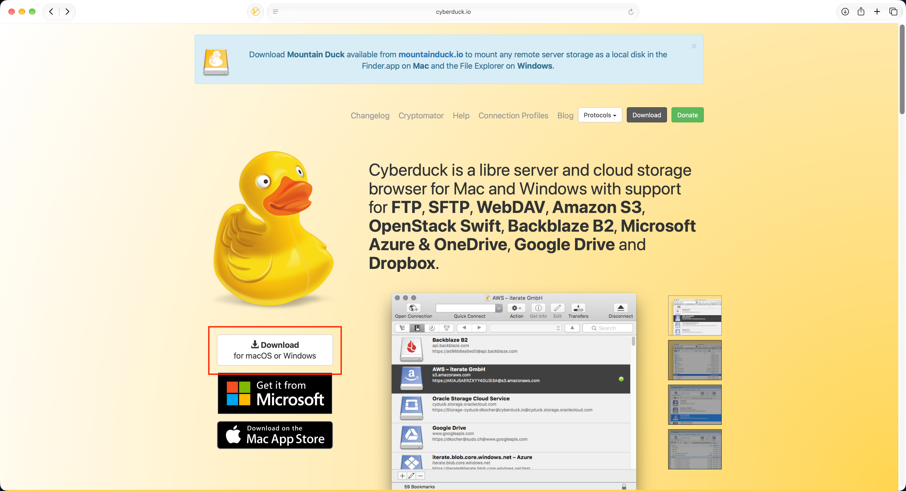
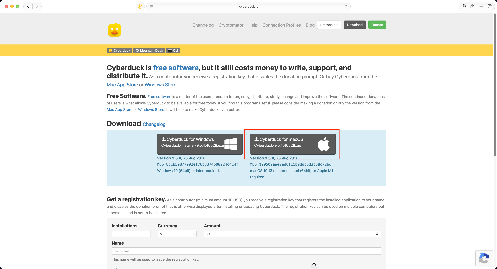
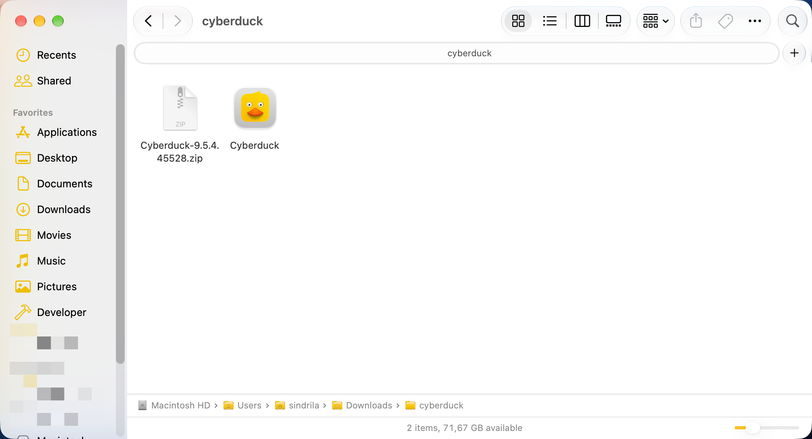
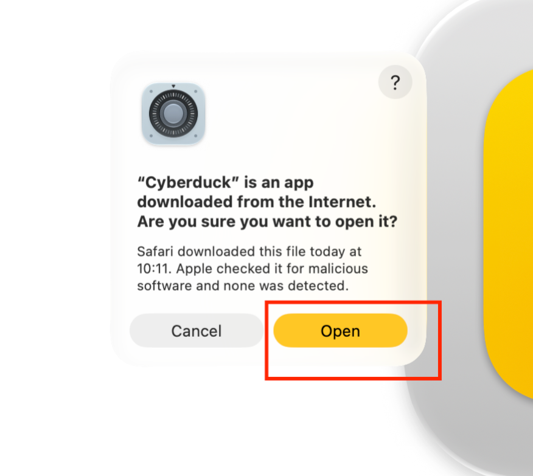
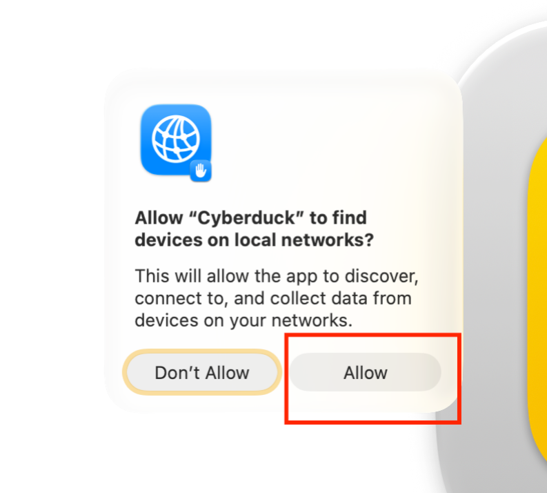
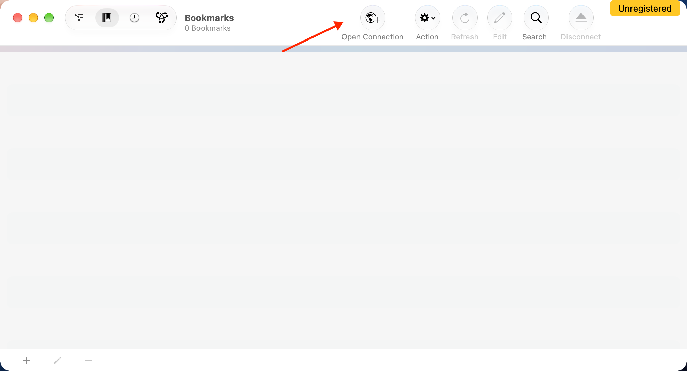
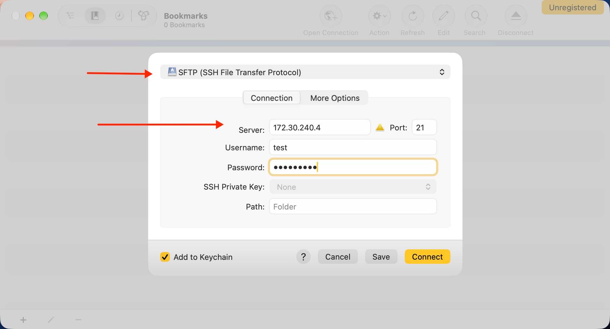
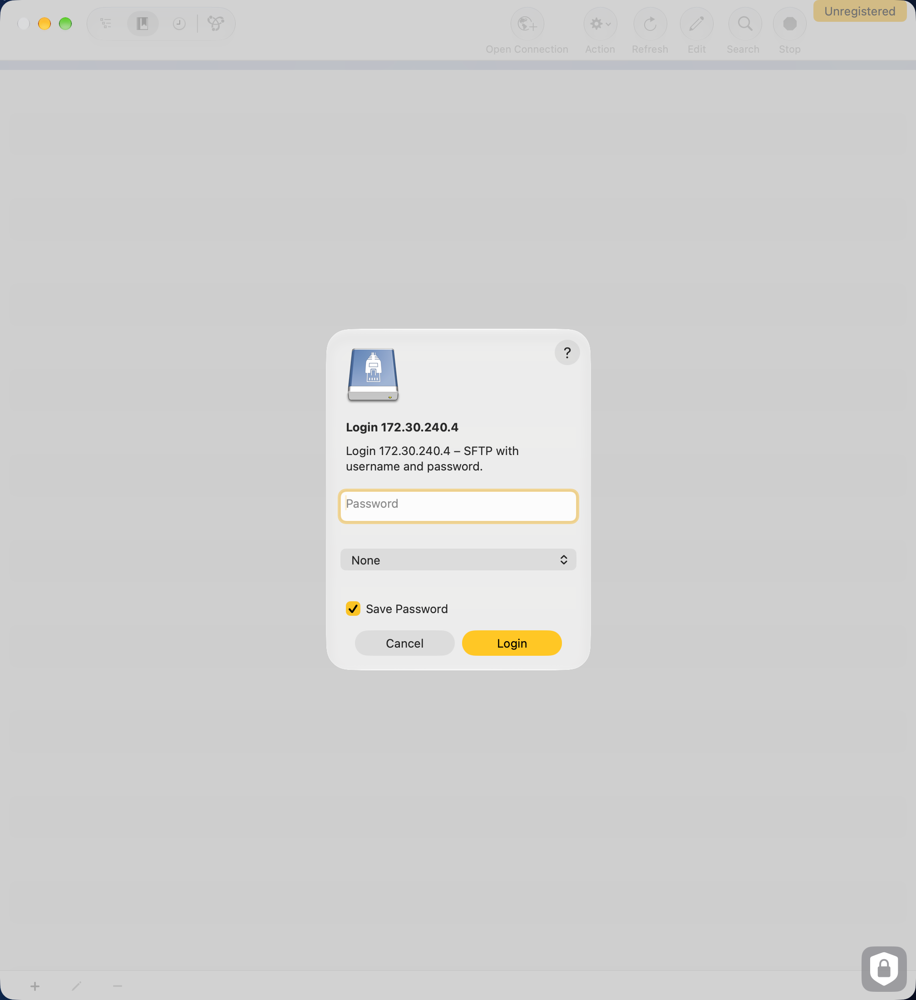
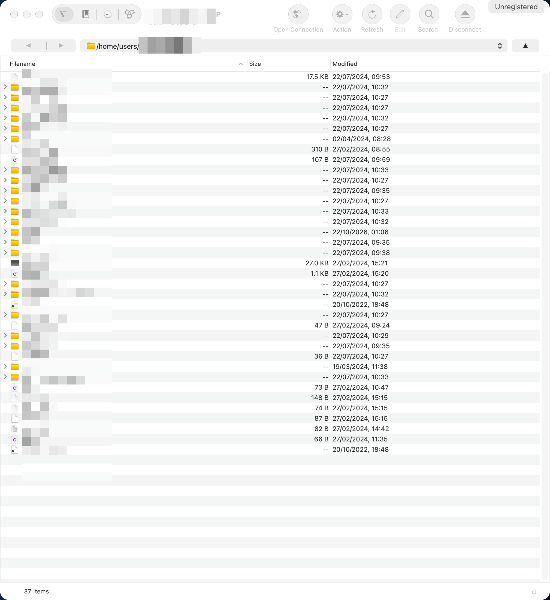

# SFTP

## Instalare Cyberduck

Cyberduck este un client open-source de SFTP pentru macOS. 
Se poate descărca de la [acest link](https://cyberduck.io), unde vom apăsa butonul de Download:

    

        
    

Alegem varianta pentru macOS:

    

        
    

Dezarhivăm fișierul descărcat și avem aplicația:

    

        
    

Apăsăm pe open:

    

        
    

Oferim acces la rețeaua locală:

    

        
    

Adăugăm o nouă conexiune:

    

        
    

Serverele dispuse de facultate sunt:
- 172.30.0.3, port 2222 -> cs.ubbcluj.ro
- 172.30.0.5, port 2222 -> math.cs.ubbcluj.ro
- 172.30.240.4, port 22 -> scs.ubbcluj.ro

Selectăm SFTP din meniul drop-down și ne punem credențialele pentru serverul la care vrem să ne conectăm, apoi apăsăm pe connect:

    

        
    

Punem din nou credențialele/cheia:

    

        
    

Acum putem accesa orice fișier:

    

        
    

